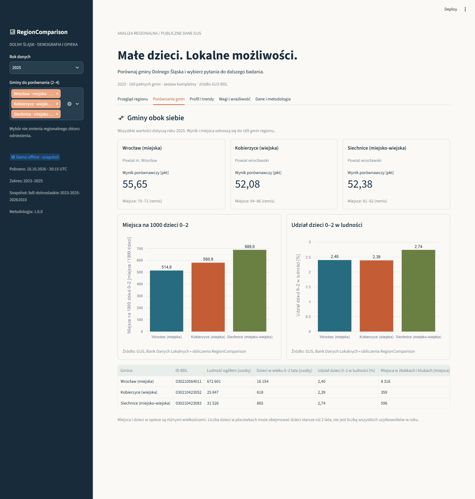

# RegionComparison

**Which municipalities merit a closer look at early childhood services?** RegionComparison brings verified public demographic and childcare data together, makes quality visible and shows how analytical priorities change a comparison.

Built by **Jonatan Tomaszewicz** with Python 3.12, PostgreSQL, SQL, Streamlit, Plotly, Docker Compose, pytest, Ruff and GitHub Actions. The interface is in Polish. Verification status and concrete evidence are recorded in [implementation status](docs/implementation-status.md).



## What you can explore

- Compare 2–4 full municipalities; selection changes the view while the reference cohort remains regional.
- Explore 169 Lower Silesian municipalities in 2023–2025: seven verified GUS source features and three local derived metrics.
- Inspect profiles, real-value trends, completeness, source definitions and quality attributes.
- Change two explicit weights, inspect percentile contributions and tie intervals, then explore a deterministic 0.1 weight grid.
- Export Excel-friendly UTF-8 CSV and JSON carrying the snapshot, definitions, exact cohort, weights and methodology version.
- Run an offline demo from the committed real snapshot or the same application using PostgreSQL.

The comparative score supports further research. It does not measure unmet demand, household accessibility, investment returns or a probability.

## Quick start on Windows

Requires Python 3.12 and PowerShell. Clone the repository, then:

```powershell
Set-Location 'C:\projekty\region-comparison'
powershell -NoProfile -ExecutionPolicy RemoteSigned -File .\scripts\bootstrap.ps1
powershell -NoProfile -ExecutionPolicy RemoteSigned -File .\scripts\run-demo.ps1
```

Open http://localhost:8503. No Docker, database or GUS API key is needed. The first dependency installation needs PyPI access; the demo then uses only committed data. RemoteSigned applies only to the launched PowerShell process and does not override Group Policy or change persistent settings. If the port is occupied, pass `-Port 8505` to run-demo.ps1. See [Windows instructions](docs/windows-setup.md) for custom Python paths and troubleshooting. Scripts preserve existing `.env` files.

## Full PostgreSQL path

Requires a running Docker Desktop with Linux containers:

```powershell
docker compose up -d --build --wait --wait-timeout 180
docker compose ps
```

Open http://localhost:8602. Compose runs PostgreSQL, migrations, idempotent validated snapshot import and the database-backed application. Data persists in a named volume. Restarts do not call GUS. `docker compose down` stops services and retains the volume.

## Data and reproducibility

Snapshot: `bdl-dolnoslaskie-2023-2025-20261010`, **169 municipalities × 3 years × 7 source variables = 3,549 source observations**. All source cells are admissible: 2,484 valid values and 1,065 true zeros. Profile features: total population, children aged 0–2, child share, care places, nurseries, child clubs, combined facilities, children attending on 31 December, published and locally computed places per 1,000 resident children aged 0–2.

The cohort excludes urban/rural parts and historical administrative records; BDL IDs are preserved separately from unverified TERYT codes. 2023–2025 follows the childcare source change to MRPiPS/RKZ 4G; earlier series are not spliced. All raw public JSON, URL/parameter/time sidecars, metadata, source attributes and file hashes are bundled with the sample.

Read [source discovery](docs/source-discovery.md), [methodology](docs/methodology.md), [data quality](docs/data-quality.md) and the [generated findings](docs/findings.md). Data source: [Statistics Poland / GUS BDL API](https://api.stat.gov.pl/Home/BdlApi). The code has an MIT license; public GUS data has separate [CC BY 4.0 attribution](data/sample/README.md).

## Architecture and operations

```text
GUS API → bounded client/cache → validation → immutable snapshot
                                              ↓
                               PostgreSQL / offline Dataset adapter
                                              ↓
                 metrics → frozen cohort → scoring / sensitivity → UI / exports
```

Modules separate configuration, ingestion, validation, storage, metrics, scoring, sensitivity, exports, UI and CLI. Definitions are snapshot scoped. [Architecture](docs/architecture.md) describes the database and transactions; SQL migration and practical queries are in `sql/`.

```powershell
.\.venv\Scripts\python.exe -m region_comparison doctor
.\.venv\Scripts\python.exe -m region_comparison discover
.\.venv\Scripts\python.exe -m region_comparison validate
.\.venv\Scripts\python.exe -m region_comparison report --output docs/findings.md
powershell -NoProfile -ExecutionPolicy RemoteSigned -File .\scripts\check.ps1
powershell -NoProfile -ExecutionPolicy RemoteSigned -File .\scripts\build-review-bundle.ps1
```

`discover` reads verified committed metadata; `discover --live` explicitly rechecks the seven source IDs. `fetch --output data/raw/new-snapshot` performs a resumable, rate-limited refresh of the pinned source scope; `load --snapshot data/raw/new-snapshot` requires DATABASE_URL and activates only validated complete snapshots. Optional GUS_CLIENT_ID is sent in X-ClientId, never the URL. No normal CI test calls GUS.

Tests cover HTTP/pagination/retry/cache contracts, source attribute semantics, denominators, fixed cohorts, weights, ties, deterministic sensitivity, reproducible exports, AppTest interactions and real PostgreSQL migrations/idempotence/adapter equivalence. CI runs offline on Windows/Linux, PostgreSQL integration and a full Docker smoke test. [Verification results](docs/verification-results.json) distinguish actual PASS/FAIL/SKIPPED/BLOCKED evidence.

## Presenting the project

The [3–5 minute demo script](docs/demo-script.md) compares Wrocław, Kobierzyce and Siechnice, inspects trends and shows why weight assumptions matter. [Findings](docs/findings.md) are generated from the committed data. Prices, queues, travel, preferences, opening hours and cross-municipal attendance are outside the dataset. Further research must check these before drawing conclusions about practical access.
