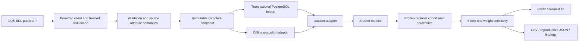

# Architecture

`ingestion` owns HTTP contracts, complete pagination, retries, rate windows and cache/checkpoint provenance. `validation` owns source semantics and activation gates. `storage` exposes the same Dataset through files and PostgreSQL. `metrics`, `scoring` and `sensitivity` own all calculations; the UI never reimplements them. `exports` records definitions, source attributes, exact cohort, scenario and methodology version. CLI performs explicit import/report operations.

PostgreSQL stores snapshot-scoped units, indicator definition versions and attributes; observations have a composite snapshot/unit/year/indicator key and foreign keys. Metadata cannot silently overwrite definitions from an older snapshot. Imports validate before activation, run inside a transaction and are idempotent for identical content. SQL migrations and useful comparison/completeness/trend queries live in `sql/`.

Compose starts a persistent PostgreSQL service, waits for its health check, performs migrations and imports the committed snapshot, then starts the database-backed application as UID 10001. Repeated initialization reuses the same snapshot. Live GUS refresh is an explicit CLI operation and never happens on application reruns or container restarts. The snapshot adapter supports an offline Windows demo with the same analytical modules.
